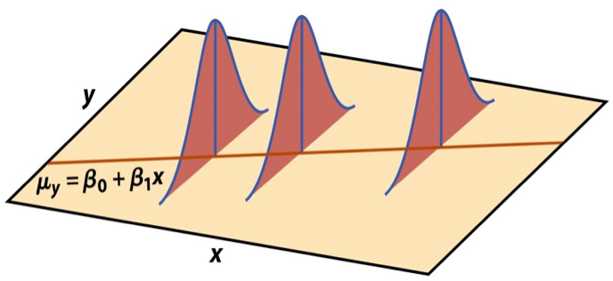
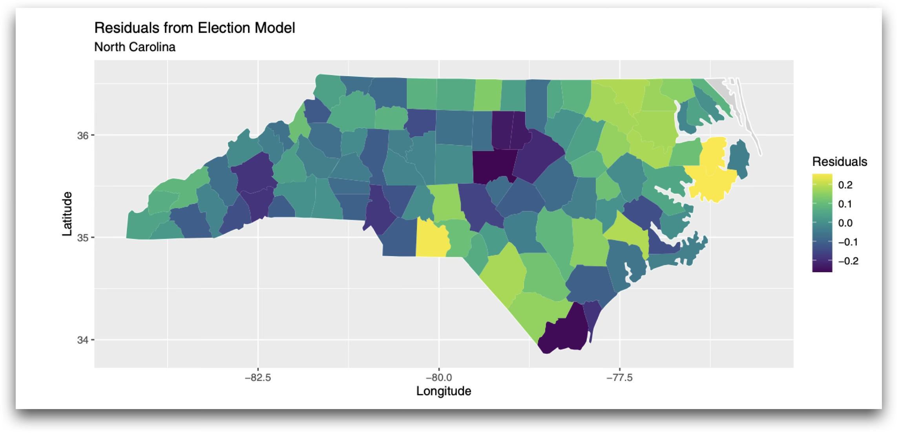

## Announcements

- SSMU Data Challenge - October 17. See [Ed Discussion](https://edstem.org/us/courses/101204/discussion/8366022) for details

- Travelers University Modeling Competition - register by October 22. See [Ed Discussion](https://edstem.org/us/courses/101204/discussion/8395549) for details

## Exam 01

- Submit regrade requests by **tomorrow, October 16 at 11:59pm**

  - Please review solutions before submitting a regrade request

- Final exam improvement incentive (see [syllabus)](https://sta221-fa26.github.io/syllabus.html#exams)\
  *For students who take all three exams, the final exam score will replace the lower of the two mid-term scores, if the final exam score is higher than the Exam 01 and/or Exam 02 score.*

## Icebreaker

::: question
What is something that has brought you joy or made you laugh lately?
:::

- Share in groups of 2 - 3

- We'll get some students to share with the class.

## Computing set up

```{r}
#| echo: true
#| message: false

# load packages
library(tidyverse)  
library(tidymodels)  
library(knitr)       
library(patchwork)   
library(viridis)

# set default theme in ggplot2
ggplot2::theme_set(ggplot2::theme_bw(base_size = 16))
```

## Topics

- Model conditions

## Data: Duke lemurs

```{r}
#| echo: false

lemurs <- read_csv("data/lemurs-sample-lt24mo.csv")
```

::: midi
Today’s data contains a subset of the original Duke Lemur data set available in the [TidyTuesday GitHub repo](https://github.com/rfordatascience/tidytuesday/blob/master/data/2021/2021-08-24/readme.md). This data includes information on `r nrow(lemurs)` lemurs less than 24 months old from three taxa:

- Eulemur rufus (ERUF), commonly known as Red-fronted brown lemur
- Propithecus coquereli (PCOQ), commonly known as Coquerel’s sifaka
- Varecia rubra (VRUB), commonly known as Red ruffed lemur.
:::

**We will explore the model conditions and diagnostics for a model of weight using age and taxon.**

## Univariate EDA

```{r}
#| echo: false

# univariate EDA

p1 <- ggplot(data = lemurs, aes(x = weight)) + 
  geom_histogram(fill = "steelblue", color = "black", binwidth = 300) + 
  labs(x = "",
       title = "Weight in grams")

p2 <- ggplot(data = lemurs, aes(x = age)) + 
  geom_histogram(fill = "steelblue", color = "black", binwidth = 1) + 
  labs(x = "",
       title = "Age in months")

p3 <- ggplot(data = lemurs, aes(x = taxon)) + 
  geom_bar(fill = "darkcyan", color = "black") + 
  labs(x = "",
       title = "Taxon")

# bivariate EDA
p4 <- ggplot(data = lemurs, aes(x = age, y = weight)) + 
  geom_point(alpha = 0.7) + 
  labs(x = "Age in months",
       y = "Weight in grams", 
       title = "Weight versus Age")

p5 <- ggplot(data = lemurs, aes(x = taxon, y = weight)) + 
  geom_boxplot(fill = "darkcyan", color = "black") + 
  labs(x = "Taxon",
       y = "Weight in grams", 
       title = "Weight versus Taxon")

p1 + (p2 / p3)

```

## Bivariate EDA

```{r}
#| echo: false
#| fig-align: center
p4 + p5
```

## Fit model

```{r}
#| echo: false

lemurs_fit <- lm(weight ~ age + taxon, data = lemurs)
tidy(lemurs_fit) |> 
  kable(digits = 3)
```

# Model conditions

## Linear regression model

$$\begin{aligned}
\mathbf{y} = \mathbf{X}\boldsymbol{\beta} + \boldsymbol{\epsilon}, \hspace{8mm} \boldsymbol{\epsilon} \sim N(\mathbf{0}, \sigma^2\mathbf{I})
\end{aligned}
$$

such that the errors are independent and normally distributed.

- **Independent**: Knowing the error term for one observation doesn't tell us about the error term for another observation
- **Normally distributed**: The distribution follows a particular mathematical model that is unimodal and symmetric
  - $E(\boldsymbol{\epsilon}) = \mathbf{0}$
  - $Var(\boldsymbol{\epsilon}) = \sigma^2\mathbf{I}$

## Assumptions for regression

$$
\mathbf{y}|\mathbf{X} \sim N(\mathbf{X}\boldsymbol{\beta}, \sigma^2\mathbf{I})
$$

{fig-align="center"}

## Assumptions for regression {.midi}

$$
\mathbf{y}|\mathbf{X} \sim N(\mathbf{X}\boldsymbol{\beta}, \sigma^2\mathbf{I})
$$

1.  **Linearity:** There is a linear relationship between the response and predictor variables.
2.  **Equal variance:** The variability about the least squares line is generally constant.
3.  **Normality:** The distribution of the errors (residuals) is approximately normal.
4.  **Independence:** The errors (residuals) are independent from one another.

. . .

::: question
After fitting a model, we check a set of conditions to evaluate whether these assumptions hold for the data.
:::

## Augment data set

```{r}
#| echo: true
lemurs_aug <- augment(lemurs_fit)
```

```{r}
#| echo: false

lemurs_aug |> 
  slice(1:10)
```

## Linearity {.midi}

- Examine plot of residuals versus fitted (predicted) values
- Good practice to also check plots of residuals versus quantitative predictors
- Linearity is satisfied if there is no discernible pattern in the plots (i.e., points randomly scattered around $\text{residuals} = 0$)

<br>

```{r}
#| echo: false
#| out-width: 65%
#| fig-align: center


resid_v_fitted <- ggplot(data = lemurs_aug, aes(x = .fitted, y = .resid)) +
  geom_point(alpha = 0.7) + 
  geom_hline(yintercept = 0, linetype = 2, color = "red") +
  labs(title = "Residuals versus Fitted")

resid_v_age <- ggplot(data = lemurs_aug, aes(x = age, y = .resid)) +
  geom_point(alpha = 0.7, color = "blue") + 
  geom_hline(yintercept = 0, linetype = 2, color = "red") + 
  labs(title = "Residuals versus Age")
```

<br>

::: question
Why does seeing no discernible pattern mean linearity is satisfied?
:::

## Linearity {.midi}

```{r}
#| echo: false
#| fig-align: center
#| out-width: 75%

resid_v_fitted + resid_v_age
```

. . .

::: question
Is linearity satisfied?
:::

```{r}
#| echo: false
#| fig-align: center
#| fig-cap: Plot made from simulated data produced by ChatGPT
#| eval: false
#| 
# code produced by chatgpt
# https://chatgpt.com/c/67bd1e0e-7650-8002-b467-1bcab2e3e172

# Simulate data where linearity is violated
set.seed(123)
n <- 100
x <- runif(n, -2, 2)
y <- x^2 + rnorm(n, sd = 0.8)  # Increased noise to obscure quadratic relationship

data <- tibble(x, y)

# Fit a linear model
model <- lm(y ~ x, data = data)

# Get residuals and fitted values
data <- data %>% 
  mutate(fitted = fitted(model), residuals = resid(model))

# Plot residuals vs fitted values
ggplot(data, aes(x = fitted, y = residuals)) +
  geom_point() +
  geom_hline(yintercept = 0, linetype = "dashed", color = "red") +
  labs(subtitle = "Residuals vs Fitted Values",
       title = "Linearity not satisfied",
       x = "Fitted Values", y = "Residuals") +
  theme_bw()


```

<!--# For multiple linear regression: if linearity is not satisfied, examine the plots of residuals versus each predictor to figure out which relationship is non-linear-->

<!--# Add higher order term(s), as needed.-->

## Equal variance {.midi}

- Examine plot of residuals versus fitted (predicted) values
- Equal variance is satisfied if the vertical spread of the points is approximately equal for all fitted values

. . .

```{r}
#| echo: false
#| out-width: 50%
#| fig-align: center

lemurs_aug <- augment(lemurs_fit)

ggplot(data = lemurs_aug, aes(x = .fitted, y = .resid)) +
  geom_point() + 
  geom_hline(yintercept = 0, linetype = 2, color = "red") + 
  labs(x = "Fitted values", 
       y = "Residuals", 
       title = "Residuals vs. Fitted Values")
```

::: question
Is equal variance satisfied?
:::

## Example: Equal variance not satisfied

```{r}
#| echo: false
#| fig-align: center
#| fig-cap: Plot made from simulated data produced by ChatGPT
#| out-width: 75%


# simulation code from Chat gpt: 
# https://chatgpt.com/c/6987e565-b408-8327-bcfe-b1ab5049c5af

set.seed(42)

# Sample size
n <- 300

# Predictor
X <- runif(n, min = 0, max = 10)

# Heteroskedastic error:
# standard deviation increases with X
sigma <- 0.5 + 0.4 * X
epsilon <- rnorm(n, mean = 0, sd = sigma)

# Linear model with non-equal variance
beta_0 <- 2.0
beta_1 <- 0.5
y <- beta_0 + beta_1 * X + epsilon

# Store in a data frame
df <- data.frame(
  X = X,
  y = y,
  sigma = sigma
)

model <- lm(y ~ X, data = df)

# Get residuals and fitted values
df <- df %>% 
  mutate(fitted = fitted(model), residuals = resid(model))

# Plot residuals vs fitted values
ggplot(df, aes(x = fitted, y = residuals)) +
  geom_point() +
  geom_hline(yintercept = 0, linetype = "dashed", color = "red") +
  labs(title = "Equal variance not satisfied",
  subtitle = "Residuals vs Fitted Values", x = "Fitted Values", y = "Residuals") +
  theme_bw()


```

. . .

- Equal variance is critical for reliable inference. Why?

- Address violations by applying transformation on the response

## Example: Equal variance not satisfied

```{r}
#| echo: false
#| out-width: 75%

ggplot(df, aes(x = fitted, y = residuals)) +
  geom_point() +
  geom_hline(yintercept = 0, linetype = "dashed", color = "red") +
  labs(title = "Equal variance not satisfied",
       subtitle = "Residuals vs Fitted Values", x = "Fitted Values", y = "Residuals") +
  theme_bw()

```

::: question
Is linearity satisfied in this example?
:::

## Normality {.midi}

- Look at the distribution of the residuals
- Normality is satisfied if the distribution is approximately unimodal and symmetric.
  - Even if normality is not satisfied, inference is robust for $n > 30$

```{r}
#| echo: false
#| fig-align: center
#| out.width: 65%

ggplot(data = lemurs_aug, aes(x = .resid)) +
  geom_histogram(fill = "steelblue", color = "black") + 
  labs(x = "Residuals", 
       title = "Distribution of residuals")
```

. . .

::: question
Is normality satisfied?
:::

## Normal Q-Q plot

- An alternative way to assess normality is by examining a Normal Q-Q Plot.

- The distribution of residuals is approximately normal if the points lie along the diagonal line

```{r}
#| code-fold: true
#| fig-align: center

ggplot(lemurs_aug, aes(sample = .resid)) +
  stat_qq() +
  stat_qq_line(color = "red") +
  labs(
    title = "Normal Q-Q Plot",
    x = "Theoretical Quantiles",
    y = "Residual Quantiles"
  )
```

## Independence

- We can often check the independence condition based on the context of the data and how the observations were collected.

  - If the data were collected in a particular order, examine a scatterplot of the residuals versus order in which the data were collected.

  - If data has spatial element, plot residuals on a map to examine potential spatial correlation.

- Can also check for dependence within subgroups that are not accounted for in the model

## Independence

Let's check whether there is unaccounted dependence by `sex`.

```{r}
#| echo: false
lemurs_aug <- lemurs_aug |>
  mutate(sex = lemurs$sex)

ggplot(data = lemurs_aug, aes(x = sex, y = .resid)) +
  geom_boxplot(fill = "steelblue", alpha = 0.3)+ 
  geom_hline(yintercept = 0, color = "red", linetype = 2) + 
  labs(x = "Sex", 
       y = "Residuals", 
       title = "Residuals versus Sex")
```

::: question
Is the independence condition satisfied?
:::

## Example of spatial correlation

Below is a visualization of the residuals for a model of the relationship between political leanings and percentage of in-person votes cast in the 2020 election.

{fig-align="center" width="75%"}

::: question
What would the map look like if independence was satisfied? Is the condition satisfied?
:::

## Example of correlation over time

```{r}
#| echo: false
#| fig-align: center
#| fig-cap: Simulation produced by ChatGPT GPT-6 Astra

set.seed(221)
n <- 150

dat <- data.frame(
  time = seq_len(n),
  predicted = seq(10, 30, length.out = n),
  residual = as.numeric(arima.sim(
    model = list(ar = 0.85), n = n, sd = 1
  ))
)

ggplot(dat, aes(x = predicted, y = residual)) +
  geom_hline(yintercept = 0, linetype = "dashed", color = "gray50") +
  geom_path(color = "gray70", linewidth = 0.4) +
  geom_point(aes(color = time), size = 2) +
  scale_color_viridis_c(name = "Time") +
  labs(
    x = "Time order",
    y = "Residuals",
    title = "Residuals with time-ordered correlation"
  ) +
  theme_minimal()
```

## Your turn

::: question
Which condition(s) must be satisfied for a linear regression model to produce reliable predictions? Select all that apply.
:::

{fig-align="center" width="30%"}

::: center
<https://app.wooclap.com/KBSSCZJ>
:::

## Recap

- Model conditions

## Before next class

- Multicollinearity

- Complete [Lecture 15 prepare](../prepare/prepare-lec15.html)
