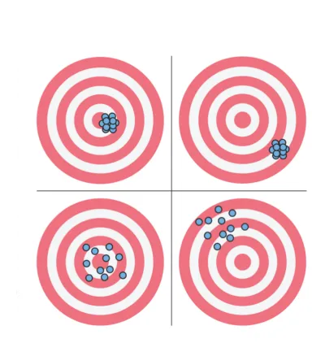

```{r setup}
#| include: false

library(countdown)

knitr::opts_chunk$set(
  fig.width = 8,
  fig.asp = 0.618,
  fig.retina = 3,
  dpi = 300,
  out.width = "80%",
  fig.align = "center"
)

options(scipen=999)
```

## Announcements

- HW 05 - due November 10 at 11:59pm

  - Released later today

- Exam 02 - November 12

  - Lecture recordings available until start of exam

- Statistics experience - due November 24 at 11:59pm

## Topics

- Matrix notation for MLE

<!-- -->

- Properties of maximum likelihood estimators

# Maximum likelihood estimation

## Side note: Multivariate normal distribution {background-color="#ccddeb"}

Let $\mathbf{z}$ be a $k \times 1$ vector such that $\mathbf{z} \sim N(\boldsymbol{\mu}, \boldsymbol{\Sigma})$. Then the probability function is

$$
P(\mathbf{z}|\boldsymbol{\mu}, \boldsymbol{\Sigma}) =(2\pi)^{-k/2} |\boldsymbol{\Sigma}|^{-1/2}\exp \left(-\frac{1}{2}(\mathbf{z} - \boldsymbol{\mu})^\mathsf{T}\boldsymbol{\Sigma}^{-1}(\mathbf{z} - \boldsymbol{\mu})\right)
$$

## MLE for linear regression in matrix form {.small}

$$
\begin{aligned}
L(\boldsymbol{\beta}, \sigma^2 | \mathbf{X}, \mathbf{y}) &= (2\pi)^{-n/2}|\sigma^2 \mathbf{I}|^{-1/2}\exp\Big\{-\frac{1}{2}(\mathbf{y} - \mathbf{X}\boldsymbol{\beta})^\mathsf{T}(\sigma^2\mathbf{I})^{-1}(\mathbf{y} - \mathbf{X}\boldsymbol{\beta})\Big\} \\[8pt]
& = \frac{1}{(2\pi)^{n/2}\sigma^n}\exp\Big\{-\frac{1}{2\sigma^2}(\mathbf{y} - \mathbf{X}\boldsymbol{\beta})^\mathsf{T}(\mathbf{y} - \mathbf{X}\boldsymbol{\beta})\Big\}
\end{aligned}
$$ <br>

. . .

$$
\begin{aligned}
\log L(\boldsymbol{\beta}, \sigma^2_\epsilon &| \mathbf{X}, \mathbf{y}) \\ 
& = -\frac{n}{2}\log(2\pi) - n \log(\sigma) - \frac{1}{2\sigma^2}(\mathbf{y} - \mathbf{X}\boldsymbol{\beta})^\mathsf{T}(\mathbf{y} - \mathbf{X}\boldsymbol{\beta})
\end{aligned}
$$

# Properties of $\hat{\boldsymbol{\beta}}$

::: callout-note
Today we will scratch the surface on the properties of estimators. This topic is covered in much greater detail in STA 332: Statistical Inference.

Our goals are to understand

- Estimators have properties

- A few properties of the least squares estimator and why they are useful
:::

## Motivation

::: incremental
- We have discussed how to use least squares and maximum likelihood estimation to find estimators for $\beta$

- How do we know whether our least squares estimator (and MLE) is a "good" estimator?

- When we consider what makes an estimator "good", we'll look at three criteria:

  - Bias
  - Variance
  - Mean squared error
:::

## Bias and variance

::: question
Suppose you throw darts at a target. Select the label for each of the four outcomes.
:::

{fig-align="center"}

## Your turn

::: question
Suppose you throw darts at a target. Select the label for each of the four outcomes.
:::

{fig-align="center" width="30%"}

::: center
<https://app.wooclap.com/BRMNSHD>
:::

## Bias and variance

- **Ideal scenario**: Darts are clustered around the target (unbiased and low variance)

- **Worst case scenario**: Darts are widely spread out and systematically far from the target (high bias and high variance)

- **Acceptable scenario:** There's some trade-off between the bias and variance. For example, it may be acceptable for the darts to be clustered around a point that is close to the target (low bias and low variance)

## Bias and variance

::: incremental
- Each time we take a sample of size $n$, we can find the least squares estimator (throw dart at target)

- Suppose we take many independent samples of size $n$ and find the least squares estimator for each sample (throw many darts at the target). Ideally,

  - The estimators are centered at the true parameter (unbiased)

  - The estimators are clustered around the true parameter (unbiased with low variance)
:::

## Properties of $\hat{\boldsymbol{\beta}}$

**Finite sample (** $n$ **)** **properties**

- Unbiased estimator

- Best Linear Unbiased Estimator (BLUE)

<br>

**Asymptotic (** $n \rightarrow \infty$ **) properties**

- Consistency

- Efficiency

- Asymptotic normality

# Finite sample properties

## Unbiased estimator

The **bias** of an estimator is the difference between the estimator's expected value and the true value of the parameter

Let $\hat{\theta}$ be an estimator of the parameter $\theta$. Then

$$
Bias(\hat{\theta}) = E(\hat{\theta}) - \theta
$$

An estimator is **unbiased** if the bias is 0 and thus $E(\hat{\theta}) = \theta$

## Expected value of $\hat{\boldsymbol{\beta}}$

Let's take a look at the expected value of least-squares estimator:

$$
\begin{aligned}
E(\hat{\boldsymbol{\beta}}) &= E[(\mathbf{X}^\mathsf{T}\mathbf{X})^{-1}\mathbf{X}^\mathsf{T}\mathbf{y}] \\[8pt]
& = (\mathbf{X}^\mathsf{T}\mathbf{X})^{-1}\mathbf{X}^\mathsf{T}E[\mathbf{y}] \\[8pt]
& = (\mathbf{X}^\mathsf{T}\mathbf{X})^{-1}\mathbf{X}^\mathsf{T}\mathbf{X}\boldsymbol{\beta}\\[8pt]
 & = \boldsymbol{\beta}
\end{aligned}
$$

## Expected value of $\hat{\boldsymbol{\beta}}$

The least squares estimator (and MLE) $\hat{\boldsymbol{\beta}}$ is an *unbiased* estimator of $\boldsymbol{\beta}$

$$
E(\hat{\boldsymbol{\beta}}) = \boldsymbol{\beta}
$$

## Variance of $\hat{\boldsymbol{\beta}}$ {.midi}

$$
\begin{aligned}
Var(\hat{\boldsymbol{\beta}}) &= Var((\mathbf{X}^\mathsf{T}\mathbf{X})^{-1}\mathbf{X}^\mathsf{T}\mathbf{y}) \\[8pt]
& = {[(\mathbf{X}^\mathsf{T}\mathbf{X})^{-1}\mathbf{X}^\mathsf{T}]Var(\mathbf{y})[(\mathbf{X}^\mathsf{T}\mathbf{X})^{-1}\mathbf{X}^\mathsf{T}]^\mathsf{T} }\\[8pt]
& = [(\mathbf{X}^\mathsf{T}\mathbf{X})^{-1}\mathbf{X}^\mathsf{T}]\sigma^2\mathbf{I}[\mathbf{X}(\mathbf{X}^\mathsf{T}\mathbf{X})^{-1}]\\[8pt]
& = \sigma^2[(\mathbf{X}^\mathsf{T}\mathbf{X})^{-1}\mathbf{X}^\mathsf{T}\mathbf{X}(\mathbf{X}^\mathsf{T}\mathbf{X})^{-1}] \\[8pt]
& = \sigma^2(\mathbf{X}^\mathsf{T}\mathbf{X})^{-1}
\end{aligned}
$$

. . .

We will show that $\hat{\boldsymbol{\beta}}$ is the "best" estimator (has the lowest variance) among the class of linear unbiased estimators

------------------------------------------------------------------------

<br>

<br>

<br>

::: {.callout-important icon="false"}
## **Gauss-Markov Theorem**

The least-squares estimator of $\boldsymbol{\beta}$ in the model $\mathbf{y} = \mathbf{X}\boldsymbol{\beta} + \boldsymbol{\epsilon}$ is given by $\hat{\boldsymbol{\beta}}$. Given the errors have mean $\mathbf{0}$ and variance $\sigma^2\mathbf{I}$ , then $\hat{\boldsymbol{\beta}}$ is **BLUE (best linear unbiased estimator)**.

"Best" means $\hat{\boldsymbol{\beta}}$ has the smallest variance among all linear unbiased estimators for $\boldsymbol{\beta}$ .
:::

## Gauss-Markov Theorem Proof

Suppose $\hat{\boldsymbol{\beta}}^\prime$ is another linear unbiased estimator of $\boldsymbol{\beta}$ that can be expressed as $\hat{\boldsymbol{\beta}}^\prime = \mathbf{Cy}$ , such that $\hat{\mathbf{y}} = \mathbf{X}\hat{\boldsymbol{\beta}}^\prime = \mathbf{XCy}$

<br>

Let $\mathbf{C} = (\mathbf{X}^\mathsf{T}\mathbf{X})^{-1}\mathbf{X}^\mathsf{T} + \mathbf{B}$ for a non-zero matrix $\mathbf{B}$.

<br>

::: question
What are the dimensions of $\mathbf{B}$?
:::

## Gauss-Markov Theorem Proof

$$
\hat{\boldsymbol{\beta}}^\prime = \mathbf{Cy} = ((\mathbf{X}^\mathsf{T}\mathbf{X})^{-1}\mathbf{X}^\mathsf{T} + \mathbf{B})\mathbf{y}
$$

We need to show

- $\hat{\boldsymbol{\beta}}^\prime$ is unbiased

- $Var(\hat{\boldsymbol{\beta}}^\prime) > Var(\hat{\boldsymbol{\beta}})$

## Gauss-Markov Theorem Proof

$$
\begin{aligned}
E(\hat{\boldsymbol{\beta}}^\prime) & = E[((\mathbf{X}^\mathsf{T}\mathbf{X})^{-1}\mathbf{X}^\mathsf{T} + \mathbf{B})\mathbf{y}] \\
& = E[((\mathbf{X}^\mathsf{T}\mathbf{X})^{-1}\mathbf{X}^\mathsf{T} + \mathbf{B})(\mathbf{X}\boldsymbol{\beta} + \boldsymbol{\epsilon})] \\
& = E[((\mathbf{X}^\mathsf{T}\mathbf{X})^{-1}\mathbf{X}^\mathsf{T} + \mathbf{B})(\mathbf{X}\boldsymbol{\beta})] \\
& = ((\mathbf{X}^\mathsf{T}\mathbf{X})^{-1}\mathbf{X}^\mathsf{T} + \mathbf{B})(\mathbf{X}\boldsymbol{\beta}) \\
& = (\mathbf{I} + \mathbf{BX})\boldsymbol{\beta}
\end{aligned}
$$

::: question
- What assumption(s) of the Gauss-Markov Theorem did we use?

- What must be true for $\hat{\boldsymbol{\beta}}^\prime$ to be unbiased?
:::

## Gauss-Markov Theorem Proof

- $\mathbf{BX}$ must be the $\mathbf{0}$ matrix (dimension = $(p+1) \times (p+1)$) in order for $\hat{\boldsymbol{\beta}}^\prime$ to be unbiased

- Now we need to find $Var(\hat{\boldsymbol{\beta}}^\prime)$ and see how it compares to $Var(\hat{\boldsymbol{\beta}})$

## Gauss-Markov Theorem Proof {.midi}

$$
\begin{aligned}
Var(\hat{\boldsymbol{\beta}}^\prime) &= Var[((\mathbf{X}^\mathsf{T}\mathbf{X})^{-1}\mathbf{X}^\mathsf{T} + \mathbf{B})\mathbf{y}] \\[8pt]
& = ((\mathbf{X}^\mathsf{T}\mathbf{X})^{-1}\mathbf{X}^\mathsf{T} + \mathbf{B})Var(\mathbf{y})((\mathbf{X}^\mathsf{T}\mathbf{X})^{-1}\mathbf{X}^\mathsf{T} + \mathbf{B})^\mathsf{T} \\[8pt]
& = \small{\sigma^2[(\mathbf{X}^\mathsf{T}\mathbf{X})^{-1}\mathbf{X}^\mathsf{T}\mathbf{X}(\mathbf{X}^\mathsf{T}\mathbf{X})^{-1} + (\mathbf{X}^\mathsf{T}\mathbf{X})^{-1}\mathbf{X}^\mathsf{T} \mathbf{B}^\mathsf{T} + \mathbf{BX}(\mathbf{X}^\mathsf{T}\mathbf{X})^{-1} + \mathbf{BB}^\mathsf{T}]}\\[8pt]
& = \sigma^2(\mathbf{X}^\mathsf{T}\mathbf{X})^{-1} + \sigma^2\mathbf{BB}^\mathsf{T}\end{aligned}
$$

::: question
What assumption(s) of the Gauss-Markov Theorem did we use?
:::

## Gauss-Markov Theorem Proof

We have

$$
Var(\hat{\boldsymbol{\beta}}^\prime) = \sigma^2(\mathbf{X}^\mathsf{T}\mathbf{X})^{-1} + \sigma^2 \mathbf{BB}^\mathsf{T}
$$

. . .

$\mathbf{BB}^\mathsf{T}$ is positive semi-definite, so $Var(\hat{\boldsymbol{\beta}}^\prime)$ is "larger" than $Var(\hat{\boldsymbol{\beta}})$ by a positive semi-definite matrix.

. . .

Therefore, we have shown that $Var(\hat{\boldsymbol{\beta}}^\prime) > Var(\hat{\boldsymbol{\beta}})$ and have completed the proof.

------------------------------------------------------------------------

<br>

<br>

<br>

::: {.callout-important icon="false"}
## **Gauss-Markov Theorem**

The least-squares estimator of $\boldsymbol{\beta}$ in the model $\mathbf{y} = \mathbf{X}\boldsymbol{\beta} + \boldsymbol{\epsilon}$ is given by $\hat{\boldsymbol{\beta}}$. Given the errors have mean $\mathbf{0}$ and variance $\sigma^2\mathbf{I}$ , then $\hat{\boldsymbol{\beta}}$ is **BLUE (best linear unbiased estimator)**.

"Best" means $\hat{\boldsymbol{\beta}}$ has the smallest variance among all linear unbiased estimators for $\boldsymbol{\beta}$ .
:::

## Properties of $\hat{\boldsymbol{\beta}}$

**Finite sample (** $n$ **)** **properties**

- Unbiased estimator ✅

- Best Linear Unbiased Estimator (BLUE) ✅

<br>

**Asymptotic (** $n \rightarrow \infty$ **) properties**

- Consistent estimator

- Efficient estimator

- Asymptotic normality

# Asymptotic properties

## Properties from the MLE

- Recall that the least-squares estimator $\hat{\boldsymbol{\beta}}$ is equal to the Maximum Likelihood Estimator $\tilde{\boldsymbol{\beta}}$

- Maximum likelihood estimators have nice statistical properties and the $\hat{\boldsymbol{\beta}}$ inherits all of these properties

  - Consistency
  - Efficiency
  - Asymptotic normality

::: callout-note
We will define the properties here, and you will explore them in much more depth in STA 332: Statistical Inference
:::

## Consistency

An estimator $\hat{\theta}$ is a consistent estimator of a parameter $\theta$ if it converges in probability to $\theta$. Given a sequence of estimators $\hat{\theta}_1, \hat{\theta}_2, . . .$, then for every $c> 0$,

$$
\displaystyle \lim_{n\to\infty} P(|\hat{\theta}_n - \theta| \geq c) = 0
$$

. . .

This means that as the sample size goes to $\infty$ (and thus the sample information gets better and better), the estimator will be arbitrarily close to the parameter with high probability.

<!--# casella berger pg. 468-->

::: question
Why is this a useful property of an estimator?
:::

## Law of large numbers {background-color="#ccddeb"}

Let $X_1, X_2, \ldots, X_n$ be independent and identically distributed random variables, such that $E(X) = \mu$, such that $\mu$ is finite.

$$
\displaystyle \lim_{n\to\infty} P(|\bar{X} - \mu| \geq c) = 0
$$

for every $c > 0$

## Mean squared error

The **mean squared error (MSE)** is the squared difference between the estimator and parameter.

. . .

Let $\hat{\theta}$ be an estimator of the parameter $\theta$. Then

$$
\begin{aligned}
MSE(\hat{\theta}) &= E[(\hat{\theta} - \theta)^2] \\
& = E(\hat{\theta}^2 - 2\hat{\theta}\theta + \theta^2) \\
& = E(\hat{\theta}^2) - 2\theta E(\hat{\theta}) + \theta^2 \\
& = \underbrace{E(\hat{\theta}^2) -  E(\hat{\theta})^2}_{Var(\hat{\theta})} + \underbrace{E(\hat{\theta})^2 - 2\theta E(\hat{\theta}) + \theta^2}_{Bias(\theta)^2}
\end{aligned}
$$

## Consistency

<br>

<br>

::: {.callout-important icon="false"}
## **Theorem**

An estimator $\hat{\theta}$ is a consistent estimator of the parameter $\theta$ if the sequence of estimators $\hat{\theta}_1, \hat{\theta}_2, \ldots$ satisfies

- $\lim_{n \to \infty} Var(\hat{\theta}) = 0$

- $\lim_{n \to \infty} Bias(\hat{\theta}) = 0$
:::

## Consistency of $\hat{\boldsymbol{\beta}}$

::: question
Show $\hat{\boldsymbol{\beta}}$ is a consistent estimator.
:::

## Efficiency {.midi}

::: incremental
- An estimator is **efficient** if it has the smallest variance among a class of estimators

- By the Gauss-Markov Theorem, we have shown that the least-squares estimator $\hat{\boldsymbol{\beta}}$ is the most efficient among linear unbiased estimators.

- Maximum Likelihood Estimators are **asymptotically efficient**
:::

::: callout-note
Proof of this in a later statistics class.
:::

## Asymptotic normality

- Maximum Likelihood Estimators are **asymptotically normal**

- Therefore, we know the distribution of $\hat{\boldsymbol{\beta}}$ is normal when $n$ is large, regardless of the underlying data

::: callout-note
Proof of this in a later statistics class.
:::

## Recap

**Finite sample (** $n$ **)** **properties**

- Unbiased estimator ✅

- Best Linear Unbiased Estimator (BLUE) ✅

<br>

**Asymptotic (** $n \rightarrow \infty$ **) properties**

- Consistency ✅

- Efficiency ✅

- Asymptotic normality ✅

## Before next class

- Complete [Lecture 20 prepare](../prepare/prepare-lec20.html)
